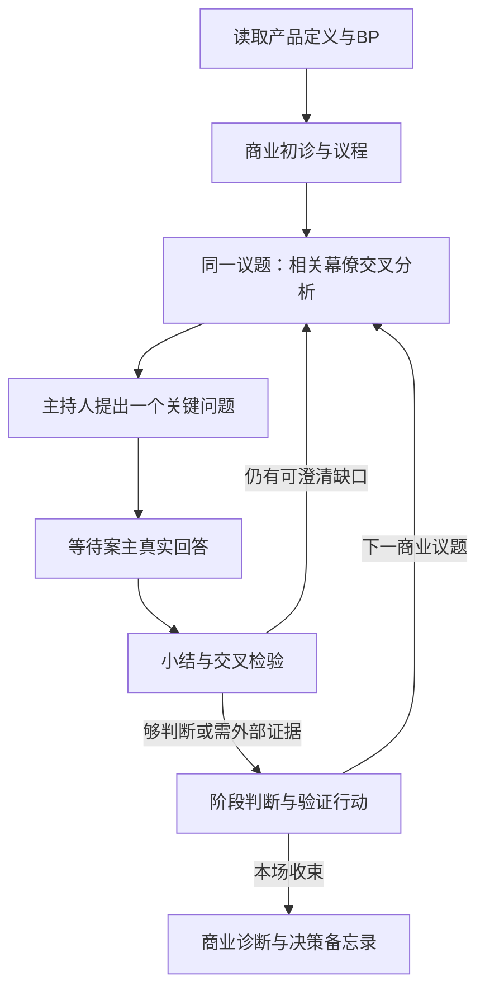

# 私董会 Skill

**1.0.0-rc14 · 公开预发布版**。让AI先读产品定义和BP，围绕商业问题主持一场逐轮诊断：主持人组织议程，幕僚从不同职责检查，案主提供真实回答并决定取舍。

## 命令安装与开始

需要Node.js/npm、Git和支持Skill的AI工具。在产品项目目录执行：

```bash
npx skills add https://github.com/wukongai/private-board-skill-public/tree/v1.0.0-rc14 --skill private-board --agent codex
```

Claude Code将`codex`换成`claude-code`；默认安装到当前项目，加`--global`才是用户范围。安装后新开会话，请AI确认读取`private-board`。当前命令固定预发布rc14，不自动追踪main或最新正式版。

[完整使用手册](https://aixiaoai.cloud/cases/cmvbo2zs200dbpo4dg1ig27eq) · [版本说明](https://github.com/wukongai/private-board-skill-public/releases/tag/v1.0.0-rc14)

> 请读取私董会Skill及我的产品定义和BP，诊断当前产品的商业逻辑。我以产品创作者身份参与。先给初诊和议程，同一个议题让相关幕僚交叉分析，由主持人每次只问我一个关键问题，等我回答。每个议题给阶段判断，最后给商业诊断与决策备忘录。

没有BP也可使用已有产品资料。默认不启用人物思维包。需要自主报告时明确说“根据资料自行讨论并给报告，保留未知，不替我编答案”。

## 它怎样工作



职责、方法、可选人物思维包分开。前台只有自然议程、小结、交接和追问，内部编号与方法映射留后台。默认一个AI切换职责；复杂审议按工具能力和权限使用sub-agent，模拟不等于真人专家或独立实证。

## 独立用，或接在AEF Product之后

本包自带[基础商业诊断框架](skills/private-board/references/business-framework.md)，不需要AEF或Python也能主持会议。它不附带第三方课程题库、完整AEF评分量表或图表工具，也不会仅凭聊清楚就打出已验证分数。

已有AEF Product资料时，把Definition/BP、研究和待决问题交给本Skill；会后将条件判断、分歧和验证行动回填原文档。完整评分需另行提供有权使用的评估能力，详见[接入与恢复](skills/private-board/references/dependency.md)。

可选[马斯克公开方法思维包](skills/private-board/references/thinking-packs/musk.md)仅组织公开方法的商业应用，不模仿本人或代表其观点。

## 验证与许可

公开包检查：`python3 -B -m unittest discover -s tests -v`。检查包边界、文件链接和隐私风险，不代替真实商业效果评测。当前为预发布版：自动模拟材料与人工验收分开，真人逐条验收尚未进行；不代表真实商业效用已验证。

[公开范围审查](docs/publication-review.md) · [版本说明](CHANGELOG.md) · [来源归属](skills/private-board/references/sources.md) · [MIT许可](LICENSE)


## 商业判断优先
先围绕客户、购买理由、收费、成本、获客和竞争组织议程。技术与交互仅在确实改变经营选择、且无法用更粗约束回答时下钻。够形成条件判断就停，未决实现问题留待产品设计；缺外部证据转验证行动。

## rc14 会议交付
开场约定目标、总预算和成果位置；每6轮检查是否已足够行动，到预算交付条件结论。临近预算只为具体可回答阻断提出有限延长，案主同意后才继续，已用轮数不归零。

已授权时首问前建草稿，每轮新决议、行动或预算变化同轮保存并回读。阅读版与后台分离，责任权限、首步窗口、停损处置未明确时不冒称完整收口。Python可用时使用随包记录器；不可用仍可聊天或手工保存，并说明未做结构校验。会议材料保存在案主项目，不写入Skill目录。

维护者另运行 `python3 -B -m unittest discover -s skills/private-board/tests -p "test_*.py" -v` 检查记录器和隔离无AEF运行。详见[rc14发布说明](docs/releases/v1.0.0-rc14.md)。

本次公开包实际通过20项检查：包边界11项、记录器8项、隔离无AEF CLI smoke 1项。7个共用主持/交付/模板/记录器核心文件与私有rc14逐字节一致；基础商业框架仍是公开独立实现。以上不代表公开包已实跑14轮模型会议，也不代替人工验收。
