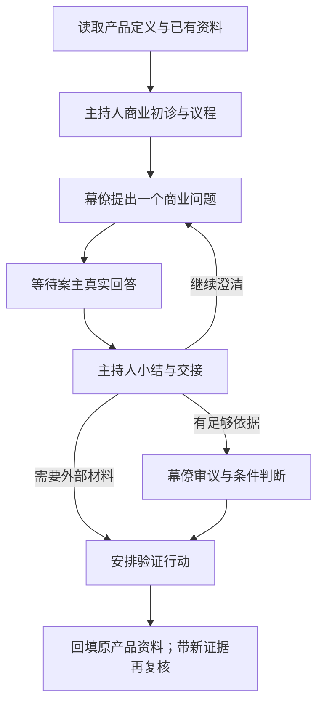

# 私董会 Skill

**1.0.0-rc7 · 公开预发布版**。让AI先读产品定义和BP，围绕商业问题主持一场逐轮诊断：主持人组织议程，幕僚从不同职责检查，案主提供真实回答并决定取舍。

## 下载与开始

- [下载页面与版本说明](https://github.com/wukongai/private-board-skill-public/releases/tag/v1.0.0-rc7)
- [直接下载完整ZIP](https://github.com/wukongai/private-board-skill-public/releases/download/v1.0.0-rc7/private-board-1.0.0-rc7.zip)
- [Skill入口](skills/private-board/SKILL.md)

解压后保留完整 `skills/private-board` 目录，让支持本地文件的AI助手读取其中的 `SKILL.md`。也可按你的助手的Skill安装说明放入该完整目录；本包不自动安装。

> 请读取私董会Skill及我的产品定义和BP，诊断当前产品的商业逻辑。我以产品创作者身份参与。先给初诊和议程，每次只问我一个问题，等我回答后再继续。

没有BP也可使用已有产品资料。默认不启用人物思维包。需要自主报告时明确说“根据资料自行讨论并给报告，保留未知，不替我编答案”。

## 它怎样工作

职责、方法、可选人物思维包分开。前台只有自然议程、小结、交接和追问，内部编号与方法映射留后台。默认一个AI切换职责；复杂审议按工具能力和权限使用sub-agent，模拟不等于真人专家或独立实证。

## 独立用，或接在AEF Product之后

本包自带[基础商业诊断框架](skills/private-board/references/business-framework.md)，不需要AEF或Python也能主持会议。它不附带第三方课程题库、完整AEF评分量表或图表工具，也不会仅凭聊清楚就打出已验证分数。

已有AEF Product资料时，把Definition/BP、研究和待决问题交给本Skill；会后将条件判断、分歧和验证行动回填原文档。完整评分需另行提供有权使用的评估能力，详见[接入与恢复](skills/private-board/references/dependency.md)。

可选[马斯克公开方法思维包](skills/private-board/references/thinking-packs/musk.md)仅组织公开方法的商业应用，不模仿本人或代表其观点。

## 验证与许可

公开包检查：`python3 -B -m unittest discover -s tests -v`。检查包边界、文件链接和隐私风险，不代替真实商业效果评测。当前为预发布版，完整连续使用效果仍需验证。

[公开范围审查](docs/publication-review.md) · [版本说明](CHANGELOG.md) · [来源归属](skills/private-board/references/sources.md) · [MIT许可](LICENSE)
